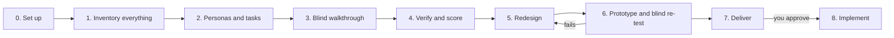

<div align="center">

# EaseFlow

**Make any product easy for the people who pay for it, without losing a single feature.**

A Claude Code skill that audits your finished product through the eyes of non-technical buyers, then redesigns how it's presented and gives you a clickable prototype in your own product's design.

[](https://github.com/shahet1124/easeflow/actions/workflows/validate.yml)
[](LICENSE)
[](CHANGELOG.md)

[Why](#why-easeflow-exists) · [Quick start](#quick-start) · [How it works](#how-it-works) · [Personas](#the-personas) · [Contributing](CONTRIBUTING.md)

</div>

---

## The Harold test

> Give your product to Harold, a 70-year-old with plenty of money and little patience for technology, and walk away.
> If he can do everything he's paying for on his own, with only a one-time guided setup, your product passes.

Most products fail this test. Not because they're bad, but because of who built them.

## Why EaseFlow exists

Software is built by developers, designers and founders who live inside it. To them, every screen makes sense. They know what a "workspace" is, why there are fourteen items in the sidebar, and which of three buttons to press first.

The people who **pay** are often different. They have money and very little time. Many aren't comfortable with technology. They don't read docs, they don't explore menus, and if something feels complicated in the first few minutes, they leave and don't come back.

It's the same lesson as the classic ["exact instructions" peanut-butter-sandwich challenge](https://www.youtube.com/watch?v=FN2RM-CHkuI): instructions only work when **every step is stated** and **no word is vague**. People who already know how to make the sandwich can't see the gaps. EaseFlow can, because it reads your product the way a newcomer does: literally.

And it does this **without dumbing your product down**. Big products need big feature sets. EaseFlow keeps every feature and changes only how and when each one is shown, so Harold meets each feature when he needs it and power users still find everything.

## What you get

Run EaseFlow on a project and it writes an `easeflow-report/` folder with:

| Deliverable | What it is |
|---|---|
| **`prototype.html`** | Your product, **in its own design** (colours, fonts, logo, components), restructured around the simpler navigation. First run and every main job are clickable end to end; every other feature is visible in its new home. Framed as a browser, phone or desktop window to match your product. |
| **`feature-ledger.md`** | Every feature, where it was, where it lives now, and how it's shown. The proof that nothing was lost. |
| **`report.md`** | The verdict, scores per persona and per job, friction points ranked by severity with evidence, the new navigation, the Advanced view decision, and before/after flow diagrams. |
| **`showcase.html`** | A one-page before/after summary for your team or client, linking to the prototype. |
| **`real-user-test.md`** | A 20-minute script for checking the prototype with five real people. No research background needed. |

Then, **only if you approve**, Claude implements the changes in your codebase, using the ledger as a checklist.

## Quick start

### Requirements

- [Claude Code](https://code.claude.com) (CLI, desktop app or IDE extension)
- A product with a user interface: web app, SaaS, mobile app, desktop app, store, marketplace, booking system or internal tool
- Optional: the app running locally or on staging, for the more accurate **live mode**

### Install as a plugin (recommended)

In a Claude Code session:

```text
/plugin marketplace add shahet1124/easeflow
/plugin install easeflow@easeflow
```

Or from your terminal:

```bash
claude plugin marketplace add shahet1124/easeflow
```

```bash
claude plugin install easeflow@easeflow
```

To get new versions later:

```bash
claude plugin marketplace update easeflow
```

### Or install as a personal skill

Clone the repo and link the skill into your personal skills folder.

macOS / Linux:

```bash
git clone https://github.com/shahet1124/easeflow.git
```

```bash
ln -s "$PWD/easeflow/skills/easeflow" ~/.claude/skills/easeflow
```

Windows (PowerShell):

```powershell
git clone https://github.com/shahet1124/easeflow.git
```

```powershell
New-Item -ItemType Junction -Path "$env:USERPROFILE\.claude\skills\easeflow" -Target "$PWD\easeflow\skills\easeflow"
```

Start a new Claude Code session afterwards.

### Run it

Open your product's folder in Claude Code and ask:

```text
Run EaseFlow on this product.
```

Or use the command directly: `/easeflow:easeflow` if installed as a plugin, `/easeflow` if installed as a personal skill.

| You want | Say |
|---|---|
| The most accurate run | "Run EaseFlow. The app is running at http://localhost:3000" |
| A run without starting the app | "Run EaseFlow, code only" |
| A specific part of a big product | "Run EaseFlow on the billing and invoicing area" |
| To build the proposal after reviewing it | "Implement the EaseFlow changes" (or approve when Claude asks) |

A full run on a large product takes a while: EaseFlow inventories every feature and runs several blind persona walkthroughs in parallel.

## How it works



| Phase | What happens |
|---|---|
| **0. Set up** | Works out the product type, the **core win** (the first outcome a customer pays for) and whether to use live mode. |
| **1. Inventory everything** | Lists **every** feature (screens, actions, settings, roles, integrations, notifications, billing), checks the list against the code, groups features into user **jobs**, and tiers them Core, Regular or Advanced. Captures your design theme. |
| **2. Personas and tasks** | Picks personas and gives each one tasks written as real-life goals, never using your product's own labels. |
| **3. Blind walkthrough** | Each persona runs as a separate agent that sees **only what's on screen**, never the code. At every step it asks: will I want to do this, will I see the control, will I understand it, and will I know it worked? |
| **4. Verify and score** | Drops findings without evidence, double-checks every Blocker, and scores each persona per job. |
| **5. Redesign** | New navigation built from your users' nouns and jobs, a home screen with one obvious next action, a short guided setup, and a home for every feature. |
| **6. Prototype and re-test** | Builds the themed prototype, then **fresh** agents test it blind. It loops until it passes, up to 3 rounds. |
| **7. Deliver** | Prototype, ledger, report, showcase and real-user test kit. |
| **8. Implement** | Only with your approval. |

The full workflow Claude follows is in [`skills/easeflow/SKILL.md`](skills/easeflow/SKILL.md).

### When does a product pass?

All five must be true:

1. **Harold** completes the first run and every core job alone.
2. **The Literal Follower** completes the first run, every core job and every regular job.
3. **Alex**, the power user, finds every advanced feature within 3 clicks of home.
4. **No Blockers** remain.
5. **100% coverage**: every feature has a home, and none was lost.

## Nothing lost: how big products stay powerful

EaseFlow never removes features. It gives every feature a **disclosure level**, choosing the lightest one that works:

| Level | Example |
|---|---|
| **Automatic** | A smart default sets the time zone, and it's still changeable in Settings |
| **Visible** | "Book appointment" on the Appointments screen |
| **In context** | "Refund" appears only on a paid invoice |
| **More options** | Repeat, reminders and notes, one click away |
| **Advanced** | Each area's own Advanced section for rare and expert features |
| **Admin** | Owner-only settings, in an admin area other roles never see |

A separate **Advanced view** for the whole product is recommended only when the evidence passes three tests: a distinct group of heavy expert users, advanced features spread across most areas, and experts needing a different layout (dense tables, bulk editing, shortcuts). Even then, it **only adds** tools. It never moves or changes anything in the simple view. See [`complexity-modes.md`](skills/easeflow/references/complexity-modes.md).

## The personas

Every run uses the first three. Then EaseFlow picks 2–3 from the library that fit your buyers, and generates 1–2 more from your product's own market.

| Persona | Role | Catches |
|---|---|---|
| **Harold**, 70, wealthy, low tech comfort | Core: the gold standard | Overall complexity, jargon, too many choices |
| **The Literal Follower** | Core: the PB&J test | Missing steps, vague labels, unstated next actions |
| **Alex**, power user switching from a competitor | Guardrail | Over-simplification, hidden capabilities |
| **Priya**, 45, CEO | Library | Slow time to value |
| **Ramesh**, 55, local business owner | Library | Unclear return on investment, setup that feels like work |
| **Frank**, 62, the skeptic | Library | Hidden pricing, unexplained permissions, no undo |
| **Linda**, 50, executive assistant | Library | Setting up for someone else, roles, handoff |
| **Grace**, 58, first-time digital user | Library | Scary errors, missing reassurance |
| **Ana**, 41, non-native English speaker | Library | Idioms, jargon, clever copy |
| **Jay**, 29, mobile only | Library | Desktop-only layouts, small tap targets |
| **Margaret**, 74, low vision | Library | Zoom, contrast, meaning shown only by colour |
| **Sam**, 38, distracted parent | Library | Lost progress, flows that can't be resumed |

Each persona has concrete "gives up when" triggers and a patience budget. See [`skills/easeflow/personas/`](skills/easeflow/personas).

## How it stays honest

Research on AI-simulated users finds they're **too successful and too agreeable**: they find paths real users miss, praise designs real users question, and invent problems that aren't there. EaseFlow is built around that:

- **Blind walkers.** Personas never see the code, the ledger or the designer's reasoning.
- **Default to fail.** Any "maybe" at any step counts as a "no".
- **Evidence or it didn't happen.** Every finding cites a file, route or screenshot. Findings without evidence are dropped.
- **Harold runs twice.** If the runs disagree, the worse result counts.
- **Measured, not imagined.** In live mode, contrast, zoom, phone width and tap target sizes are measured.
- **Blind re-test.** The redesign is judged by fresh agents, not by the one that designed it.
- **Real people last.** The test kit checks the findings that matter with five real people before you build.

EaseFlow combines established methods: **cognitive walkthroughs** (Wharton et al.), **top tasks** (Gerry McGovern), **object-oriented UX**, **progressive disclosure** (Nielsen) and **WCAG** accessibility checks.

## FAQ

**Will it change my code?**
Not unless you approve. It writes a report and a prototype first, then asks.

**Does it work on mobile or desktop apps?**
Yes. It reads Flutter, React Native, SwiftUI, Android and desktop themes, and frames the prototype as a phone or window.

**My product is huge. Will it cope?**
Yes. Big products are split by module and inventoried in parallel, every feature goes into the ledger, and the coverage gate makes sure none is lost. You can also point it at one area at a time.

**Does it replace user testing?**
No. It's a fast, thorough first pass that finds most of the obvious problems before real people see them. The included test kit helps you confirm the findings with five real people.

**Is my code sent anywhere?**
EaseFlow itself has no server and sends nothing anywhere. Your code is handled by Claude Code exactly as in any other session. See [SECURITY.md](SECURITY.md).

**Should I commit `easeflow-report/`?**
That's up to you. It describes your product's screens and features, so keep it out of public repos unless you're happy to share it.

## Limitations

- It's a simulation. It can't tell you whether people actually want your product. Only real customers can.
- **Code-only mode** can't see runtime behaviour (loading states, real data, performance), so live mode is more accurate.
- Very large products take longer and use more tokens. Running it per area helps.
- The prototype shows the redesign. It isn't production code.

## Repository layout

```
.claude-plugin/
  plugin.json                     plugin manifest
  marketplace.json                install straight from this repo
skills/easeflow/
  SKILL.md                        the workflow (phases 0–8)
  personas/                       12 personas + _template.md
  references/
    feature-coverage.md           inventory, jobs, tiers, ledger, coverage gate
    complexity-modes.md           disclosure ladder and Advanced view rules
    scoring.md                    metrics, scores, pass/fail, verdict
    simplification-rules.md       rules R1–R28
    prototype-guide.md            capturing the theme and building the prototype
    report-template.md            the report's exact structure
    real-user-test.md             the real-people test kit
  assets/
    prototype-skeleton.html       base for the themed, clickable prototype
    showcase-template.html        the before/after summary page
scripts/validate.py               repo consistency checks (run in CI)
```

## Contributing

Contributions are very welcome, especially **run reports** from real products and **personas** that catch problems the current ones miss. Read [CONTRIBUTING.md](CONTRIBUTING.md) for the rules (nothing lost, code only on approval, blind walkers, evidence for every finding) and how to test a change.

Please follow the [Code of Conduct](CODE_OF_CONDUCT.md). Report security problems privately, as described in [SECURITY.md](SECURITY.md).

## License

[MIT](LICENSE) © 2026 Het Shah and EaseFlow contributors.

## Acknowledgements

- The "Exact Instructions Challenge" by Josh Darnit, which inspired the Literal Follower.
- Cathleen Wharton, John Rieman, Clayton Lewis and Peter Polson's cognitive walkthrough method.
- Gerry McGovern's Top Tasks, Jakob Nielsen's progressive disclosure, and the object-oriented UX community.
- The GOV.UK accessibility personas and Microsoft's inclusive design toolkit, which shaped the persona library.
